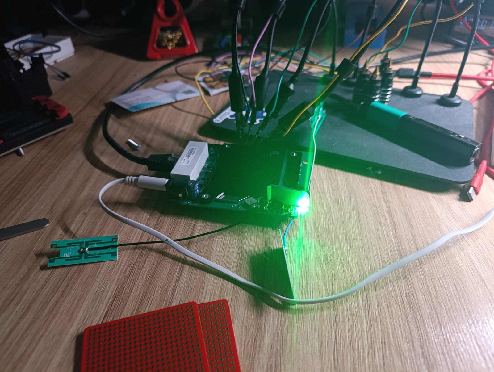

# OpenWrt on the TP-Link Deco X55 v3

An OpenWrt port for the **TP-Link Deco X55 v3** (AX3000 mesh unit, MediaTek MT7981B), with a
Deco-style mesh on top: two or more units, batman-adv over 802.11s, push-button pairing with
approval in LuCI, roaming between units.

It is a hobby project. It works on the two units it was developed on; read the
[install guide](INSTALL.md) and the limitations below before you open yours.

Writeup with photos: <https://andreivladescu.github.io/Deco-X55-OpenWrt/>.
Images: [releases page](https://github.com/AndreiVladescu/Deco-X55-OpenWrt/releases).



> **v3 only.** The Deco X55 v1.x is a Qualcomm IPQ5018 device and has nothing in common with this
> one. Check the label for hardware version 3.0.

## Status

| | |
|---|---|
| Boots from flash through TP-Link's own bootloader, stock firmware kept in the second slot | ✅ |
| Ethernet: 2× LAN (MT7531 switch), 1× WAN (internal PHY), hardware NAT (PPE) | ✅ |
| Wi-Fi: 2.4 GHz HE40 + 5 GHz **HE160** 2×2, WPA2/WPA3, unit-specific calibration | ✅ |
| Wi-Fi ↔ Ethernet hardware offload (WED) | ✅ |
| RGB status LED, reset button | ✅ |
| Mesh (batman-adv over 802.11s), roaming with usteer (802.11k/v) | ✅ |
| Push-button pairing of new units, approval in LuCI | ✅ |
| `sysupgrade` / LuCI firmware upgrade, settings kept | ✅ |
| Install from stock (RAM boot + `sysupgrade -n`) end to end | not yet run as one sequence |
| Wired backhaul over the Ethernet ports, ~7 s failover to the mesh on a cable pull | ✅ |
| Install without opening the case | ❌ not possible (see below) |

Measured on the test units:

* 5 GHz client throughput (iPhone 15): 520–530 Mbit/s — the same as the stock firmware.
* Mesh backhaul link: 2401.9 Mbit/s PHY (HE160, MCS 11, 2 streams); ~450–650 Mbit/s iperf3 between units.
* Hardware offload: 350 Mbit/s routed with the CPU 86–100 % idle.

## Hardware

| | |
|---|---|
| SoC | MediaTek MT7981B, 2× Cortex-A53 @ 1.3 GHz |
| RAM | 512 MiB DDR3 |
| Flash | 128 MiB SPI-NAND |
| Ethernet | 3× 1 GbE: MT7531 switch (2 ports) + MT7981 internal PHY |
| Wi-Fi | MT7981 built-in, 2×2 2.4 GHz + 2×2 5 GHz, 802.11ax, 160 MHz, external FEMs |
| LED / buttons | one RGB LED (GPIO 9/12/28), reset (GPIO 1) |
| Serial | 3.3 V, 115200 8N1, pads on the board (case must be opened) |

## How it boots

TP-Link's bootloader chain is left untouched. The flash holds two firmware slots; a U-Boot
variable picks one:

```
BootROM → BL2 → BL31 → TP-Link U-Boot ──tp_boot_idx──┬─ slot 0 (ubi0): OpenWrt
                                                      └─ slot 1 (ubi1): stock firmware (kept)
inside a slot:  "uboot" volume (TP-Link 2nd-stage U-Boot) → FIT "kernel" (config-X50_3_0_0) → "rootfs"
```

OpenWrt is installed into slot 0 next to TP-Link's second-stage U-Boot, which stays where it is,
so the images contain no TP-Link code. Going back to stock is a single variable:
`fw_setenv tp_boot_idx 1`.

Each unit's Wi-Fi calibration and MAC address are files inside a UBIFS volume (`factory_data`),
read at boot — the same layout as the Mercusys Halo H90X, which OpenWrt already supports.

## Why the case has to be opened

TP-Link only accepts signed firmware: the stock upgrade (app or local) checks an RSA-2048 PSS
signature, an MD5 and a product/hardware/OEM support list, and the bootloader's web recovery page
uses the same checks. There is no unsigned TFTP recovery. The first install therefore needs the
serial console to boot OpenWrt from RAM; every later upgrade is done from OpenWrt itself.

## Installing

Short version — the full, careful version with the reasons for each step is in [INSTALL.md](INSTALL.md):

1. Open the case, connect a 3.3 V UART adapter (GND/TX/RX only), make a full flash backup.
2. Stop TP-Link's U-Boot, TFTP-boot the `initramfs-kernel.bin` image into RAM.
3. In the RAM-booted OpenWrt: `sysupgrade -n` with the `sysupgrade.bin` image.
4. Log in at `https://192.168.1.1` as `root`, password `deco-modded` — change it.

## The mesh

Every unit can be the main unit or a satellite; there is no app and no cloud.

1. Main unit (internet on its WAN socket): short press on the reset button, or LuCI →
   Network → **Mesh nodes** → *Create a mesh here*. The LED blinks blue: pairing is open for 2 min.
2. New unit: short press on its reset button. It finds the main unit over a temporary
   WPS-protected link and asks to join.
3. LuCI on the main unit shows the request — **Approve**. The new unit receives the mesh key and
   Wi-Fi settings, turns all its sockets into LAN ports and joins. LED solid green.

Under the hood: batman-adv over an SAE-encrypted 802.11s link on 5 GHz (same channel as the
access points), batman on VLAN 42 of the Ethernet ports for wired backhaul, bridge loop
avoidance, and usteer for band steering and 802.11v roaming between units.

## What's in the image

On top of OpenWrt `main` (Linux 6.18): LuCI over HTTPS, the full hostapd (WPA3, 802.11k/v/r,
802.11s, WPS), batman-adv, usteer, WireGuard, OpenVPN, SQM, UPnP, DDNS, nlbwmon, Wake-on-LAN,
`htop`, `iperf3`.

Defaults (applied once, and only to settings that are still at OpenWrt's defaults): 5 GHz on
channel 44 at 160 MHz like the stock firmware, 2.4 GHz at 40 MHz, one network name `Deco-OpenWrt`
on both bands, the regulatory country from the unit's own factory data, Wi-Fi off until you set a
password, hardware offload on.

## Known limitations

* 160 MHz on channel 44 includes DFS channels: ~60 s radar check after every boot, and a radar
  event moves the whole mesh to another channel.
* usteer is patched to prefer 5 GHz targets when roaming (it used to pick the louder 2.4 GHz radio
  first); this still needs a confirming walk test.
* batman over the backhaul VLAN fragments packets at MTU 1500. Jumbo frames would avoid that, but
  every switch on the path would have to pass them, so it is left alone.
* Stability: a first 1.4-hour soak test was clean; an overnight run is still to do.
* Traffic over the mesh is forwarded by the CPU (batman-adv is not hardware-offloaded).
* Tested on two units only, against OpenWrt `main` — not an official OpenWrt target (yet).

## Building

```sh
tools/setup_openwrt.sh        # OpenWrt at the tested commit + device patch + this repo's packages
cd openwrt && make -j$(nproc)
```

Images end up in `openwrt/bin/targets/mediatek/filogic/`. Prebuilt images are on the
[releases page](https://github.com/AndreiVladescu/Deco-X55-OpenWrt/releases).

## Repository

| | |
|---|---|
| [`openwrt-patches/`](openwrt-patches) | device support for OpenWrt (device tree, image, board scripts) |
| [`packages/deco-mesh`](packages/deco-mesh) | pairing, mesh setup, LuCI *Mesh nodes* page, reset-button handling |
| [`packages/deco-x55-defaults`](packages/deco-x55-defaults) | first-boot defaults |
| [`config/`](config) | build configuration |
| [`tools/`](tools) | serial/U-Boot helpers, flash backup, RAM-boot test loop, soak test |
| [`INSTALL.md`](INSTALL.md) | installation guide |
| [`docs/JOURNAL.md`](docs/JOURNAL.md) | how the port was done, including everything that went wrong |
| [`index.md`](index.md), `img/` | the GitHub Pages writeup and photos |
| [`docs/DEVELOPMENT.md`](docs/DEVELOPMENT.md) | development and test setup |

## Thanks

Built on [OpenWrt](https://openwrt.org) and MediaTek's open-source `mt76` driver. The Mercusys
Halo H90X and MR80X v3 ports in OpenWrt showed the way for TP-Link's flash layout and dual-slot
boot.

## Disclaimer

Flashing third-party firmware can brick your device and voids its warranty. Back up the flash
first. You are on your own — but the stock firmware stays installed in the second slot, so the
way back is short.
