<link  rel="shortcut icon"  type="image/x-icon"  href="icon.ico">
<style>td { vertical-align: middle; }</style>
<figure>  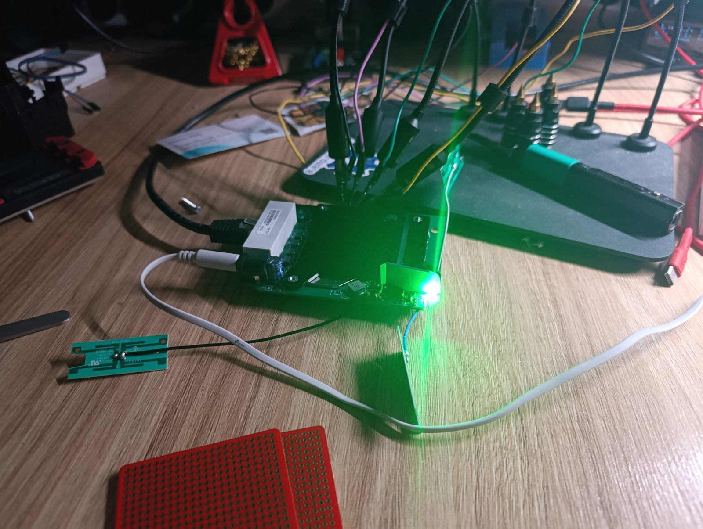  </figure>


# Introduction

The TP-Link Deco X55 is an AX3000 mesh router sold in packs of two or three. I bought the two-pack, and while
they work fine, the stock firmware is locked by Tp-Link, setup goes through a phone app, a TP-Link account and there is
no shell. OpenWrt would fix that, but there was no port for the **v3** hardware revision,
 which is MediaTek-based (the older v1.x units use a Qualcomm chip and
have nothing in common with it). I found some online resources: [forum.openwrt.org](https://forum.openwrt.org/t/openwrt-for-tp-link-deco-x55/242148/33) but
my hardware is a bit different from theirs and they didn't put up a build to try for myself.

So I opened both units and tried to port it, with the goal of keeping what the Decos do well: one
network across both units, a fast wireless link between them, and roaming between them. These units are *EU/3.0* versions, make sure you get these specific versions.

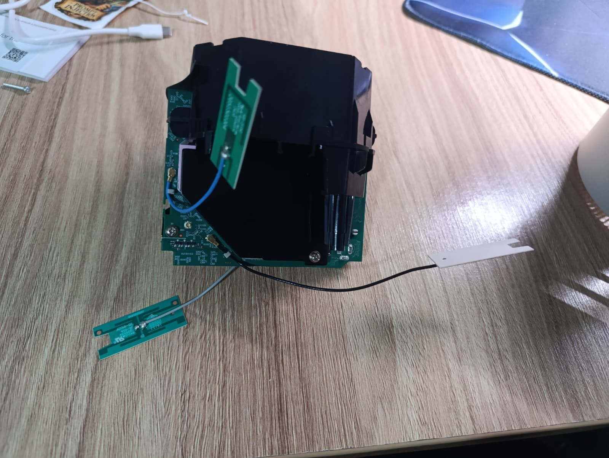


# Internal Photos

Inside the case there's a plastic core with the PCB antennas around it, and a single board sandwiched
between two metal heatsink plates.

<div style="display: flex; flex-direction: row; align-items: center;">
  
  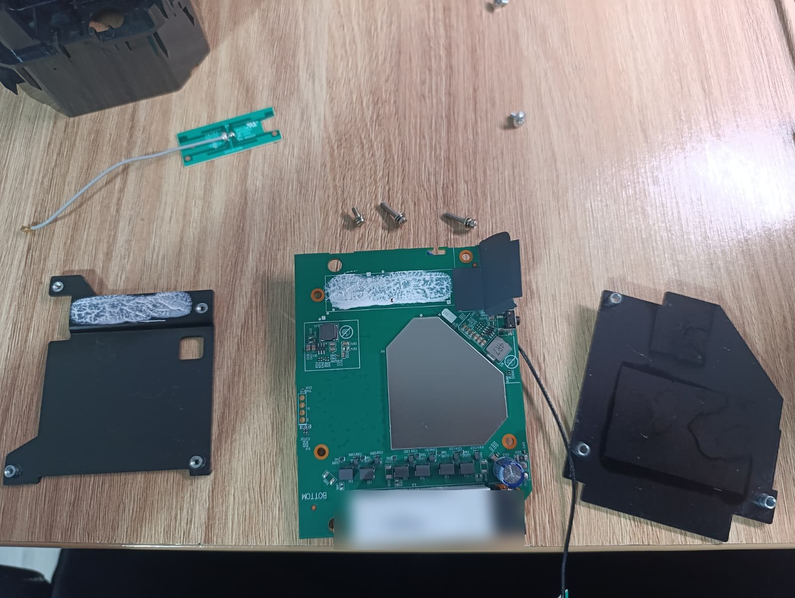
</div>

<div style="display: flex; flex-direction: row; align-items: center;">
  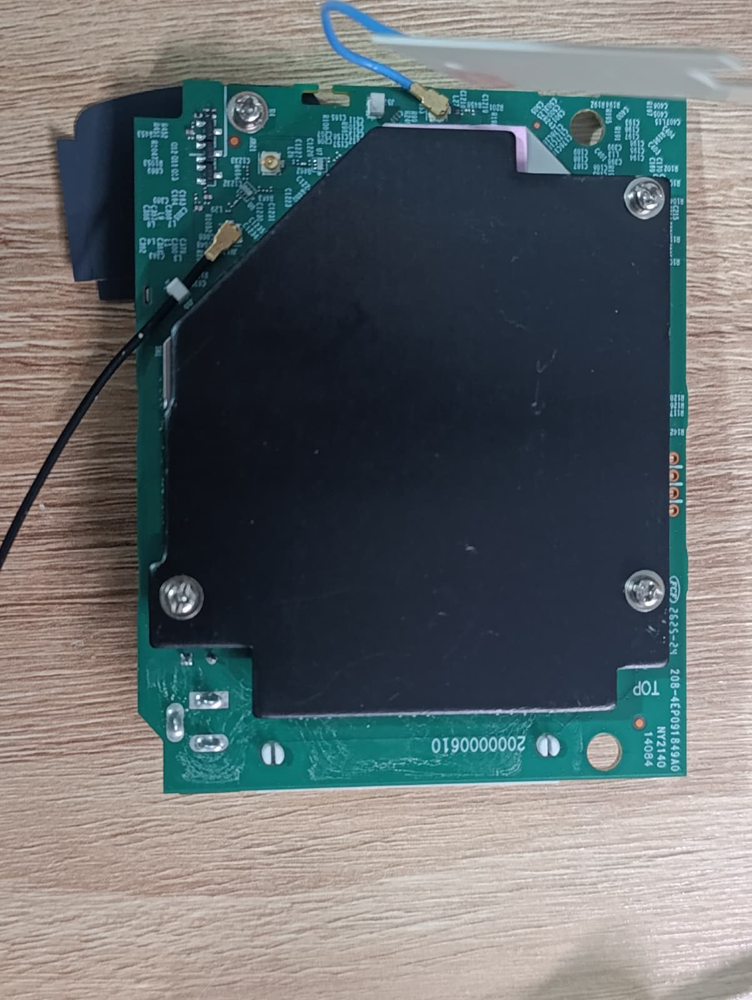
  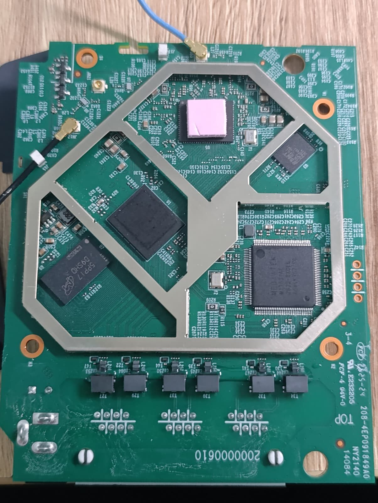
</div>

| Component | Name | Image | Notes |
| --------- | ---- | ----- | ----- |
| SoC | MediaTek MT7981BA (Filogic 820) | 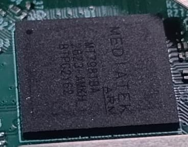 | 2× Cortex-A53 @ 1.3 GHz, hardware NAT and Wi-Fi offload |
| Wi-Fi | MediaTek MT7976CN | 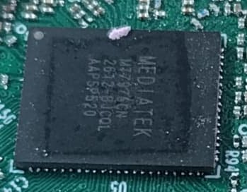 | 2×2 2.4 GHz + 2×2 5 GHz, up to 160 MHz |
| RAM | Micron D9SHD, 512 MiB DDR3L | 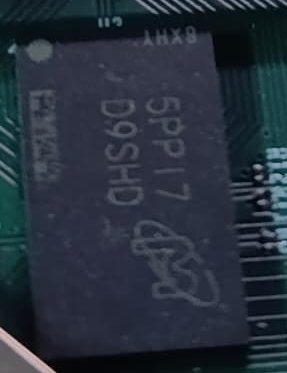 | |
| Flash | ESMT SPI-NAND, 128 MiB | 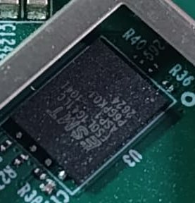 | |
| Switch | MediaTek MT7531AE | 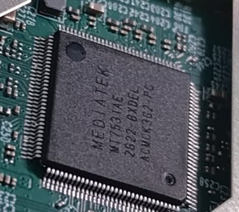 | two of the three Ethernet ports; the third (WAN) uses the SoC's own PHY |

The board also has a single RGB LED, the reset button, and a 4-pin UART header (3.3 V, 115200 baud),
which is how I got in.

Pins are TX/RX/GND/3V3:

<div style="display: flex; flex-direction: row; align-items: center;">
  
  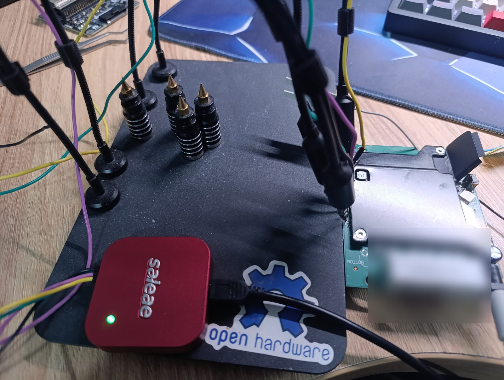
</div>


# Backing up the flash

Before writing anything, I wanted a full copy of the flash of both units. This took longer than the
port itself.

UART on the unit fully booted doesn't accept any input, only outputs data.

TP-Link's U-Boot can be interrupted with Ctrl-C, but it can only download files, not upload them. The only
way out was printing the flash as hex on the serial console, which at 115200 baud would take about 13 hours
for 128 MiB. Writing the UART's clock registers by hand got it to 1 Mbaud. That worked for the
bootloader, but long transfers at that speed made my PC's USB controller crash, twice.

Booting the stock Linux didn't help either. TP-Link removed OpenWrt's failsafe mode, and their kernel
only transmits on the UART, so you get a root prompt that never receives a keystroke. What worked in the
end was passing a shell script on the kernel command line (`init=/bin/sh -- -c "..."`), so the commands
run without any input. The script starts a small TCP server that serves each flash partition, and
the PC downloads them over the network. The whole chip came out in about 25 seconds, verified with SHA-256 on
both sides.

One more surprise: with that minimal boot, the switch ports pass no traffic at all. TP-Link's userspace
normally rewrites two switch registers after boot, so the script has to do that itself.


# Porting OpenWrt

The boot process has two U-Boots, and the second one lives inside the firmware slot:

```
BootROM → BL2 → BL31 → TP-Link U-Boot
        → second U-Boot (inside the active firmware slot)
        → kernel (FIT, config "config-X50_3_0_0") → root filesystem
```

There are two firmware slots, and a U-Boot variable (`tp_boot_idx`) chooses which one boots. The Wi-Fi
calibration data is not on a raw flash partition, like on most routers, but stored as a file inside a
UBIFS volume.

OpenWrt already supports the Mercusys Halo H90X, which is also made by TP-Link and uses the same flash
layout, so most of the work was already there. What the Deco needed on top of it:

- the kernel image's configuration named `config-X50_3_0_0`, otherwise TP-Link's second U-Boot won't boot it
- the Wi-Fi calibration file passed to the `mt76` driver
- the MAC addresses, the same as stock (LAN, WAN, 2.4 GHz and 5 GHz are consecutive)
- the LED pins: the stock device tree lists seven for a whole family of models, and I found the three
  that are actually connected by turning them on one at a time and asking someone what colour the LED was

The first OpenWrt boot, from RAM over TFTP, worked. For the installation, OpenWrt goes into the first slot
with `sysupgrade` and keeps TP-Link's second U-Boot that is already there, so no TP-Link files need to be
distributed. The stock firmware stays in the second slot, and `fw_setenv tp_boot_idx 1` boots it again.

I also checked whether the stock web interface could be used to install it. It can't: both the stock
upgrade and the bootloader's recovery page check an RSA signature from TP-Link.


# Mesh

The stock firmware uses TP-Link's own mesh software on top of MediaTek's closed Wi-Fi driver. I
replicated the behaviour with standard OpenWrt packages:

| | Stock | OpenWrt |
| --- | --- | --- |
| Link between units | hidden Wi-Fi network, both bands | 802.11s on 5 GHz, 160 MHz, with batman-adv on top |
| Cable between units | automatic | batman-adv on a VLAN of each Ethernet port |
| Roaming | 802.11k/v | 802.11k/v, usteer |
| Adding a unit | phone app | button on both units, then approve it in the web interface |

For adding units, I wrote a small package (`deco-mesh`): a short press on the button opens a two-minute
pairing window on the configured unit, and a short press on the new unit makes it ask to join. The request shows
up in LuCI under Network → Mesh nodes, and after you approve it the new unit receives the mesh and Wi-Fi
settings. The LED shows the state (blue = not set up, blinking blue = pairing, green = in the mesh).

Two problems came up while testing:

- Phones roaming to the other unit landed on 2.4 GHz first, because usteer picks the strongest signal and
  2.4 GHz is always louder. A small patch gives 5 GHz a 10 dB advantage.
- With both units cabled to the same switch, pulling one cable made that unit unreachable for about 70
  seconds. batman-adv's loop protection kept treating it as "still on the cable" until a timeout ran
  out. Shortening that timeout brought it down to about 7 seconds.


# Results

Measured on my two units:

- an iPhone 15 gets 520–530 Mbit/s on 5 GHz, the same as with the stock firmware on the same unit
- the link between the units runs at 2401.9 Mbit/s (160 MHz, 2 streams), around 450–650 Mbit/s in iperf3
- routing between WAN and LAN uses the hardware offload, with the CPU mostly idle at 350 Mbit/s
- with a cable between the units, pulling it switches over to Wi-Fi in about 7 seconds
- a first 1.5-hour stability test had no reboots and no memory growth

Not done yet:

- installing from a stock unit as one sequence (each step was tested on its own)
- a longer stability test


# Installing

Installing requires opening the case and a 3.3 V USB-UART adapter. The steps are in
[INSTALL.md](https://github.com/AndreiVladescu/Deco-X55-OpenWrt/blob/main/INSTALL.md), and the images are
on the [releases page](https://github.com/AndreiVladescu/Deco-X55-OpenWrt/releases). In short: back up
your flash, boot the initramfs image from U-Boot over TFTP, then `sysupgrade -n` with the sysupgrade
image. The default password is `deco-modded`.

There is also a script, `tools/deco_flash.py`, that does the backup and the installation in one go
from Linux or Windows: you start it, power on the Deco, and it handles U-Boot, the backup, TFTP and
`sysupgrade`. I haven't run it on a real unit yet, only against a simulated one.

The source (device patch, packages, tools) is in the
[repository](https://github.com/AndreiVladescu/Deco-X55-OpenWrt), and the full notes from the port,
including the dead ends, are in [docs/JOURNAL.md](https://github.com/AndreiVladescu/Deco-X55-OpenWrt/blob/main/docs/JOURNAL.md).
