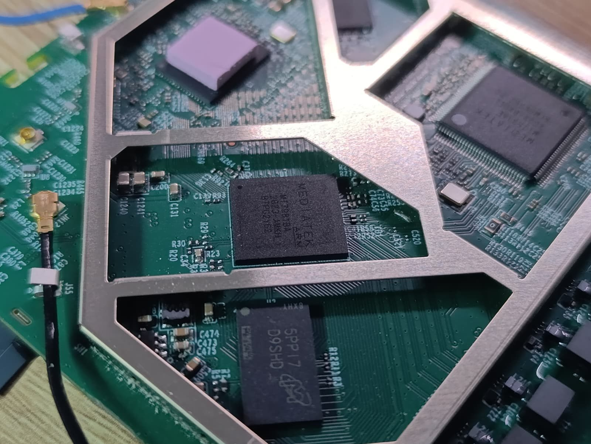
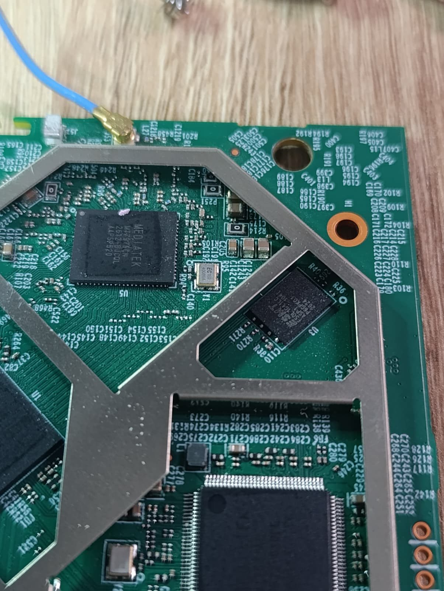
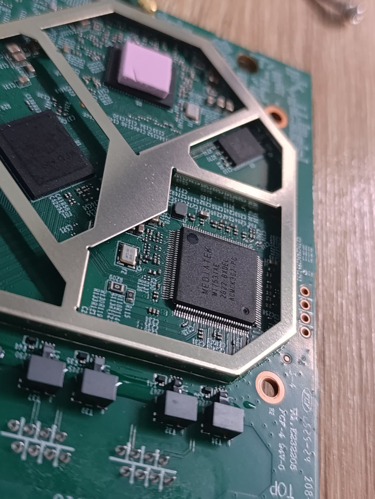
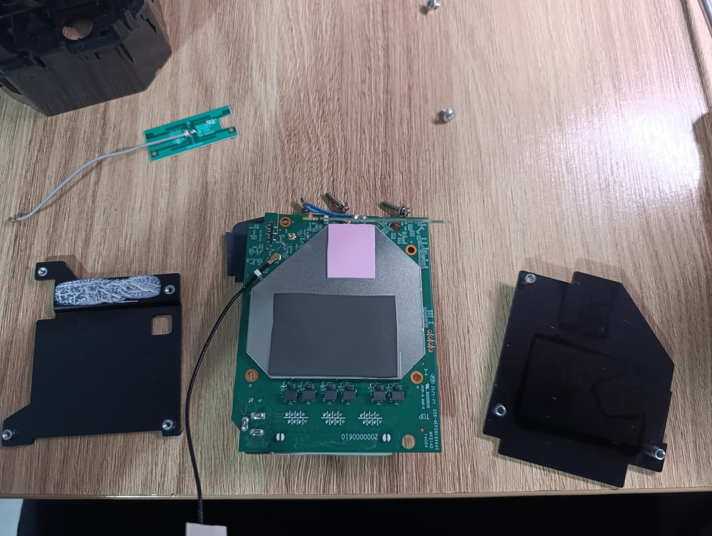
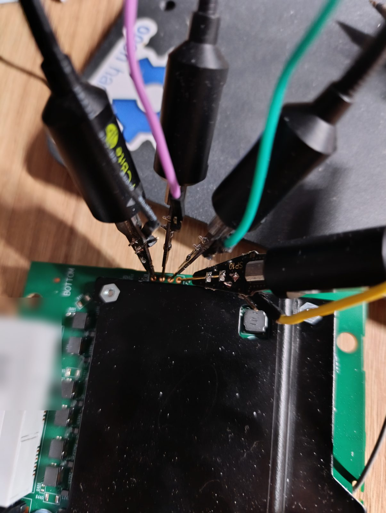

<link rel="shortcut icon" type="image/x-icon" href="icon.ico">
<link rel="stylesheet" href="https://cdn.jsdelivr.net/npm/swiper@12/swiper-bundle.min.css">

<style>
/* ── Gallery ──────────────────────────────────────────────────────────── */
.pcb-swiper{
  max-width: 980px;
  margin: 1rem auto 0.75rem;
  border-radius: 16px;
  overflow: hidden;
  box-shadow: 0 12px 40px rgba(0,0,0,.10);
  background: rgba(0,0,0,.02);
}
.pcb-swiper .swiper-slide{
  display:flex;
  align-items:center;
  justify-content:center;
  background: rgba(0,0,0,.02);
}
.pcb-swiper .swiper-zoom-container{
  width:100%;
  height: min(72vh, 760px);
  display:flex;
  align-items:center;
  justify-content:center;
}
.pcb-swiper img{
  width:100%;
  height:100%;
  object-fit: contain;
  display:block;
  user-select: none;
  -webkit-user-drag: none;
}
.pcb-gallery-controls{
  max-width: 980px;
  margin: 0 auto 2rem;
  display:flex;
  align-items:center;
  justify-content:space-between;
  gap: 12px;
}
.pcb-gallery-controls button{
  border:0;
  cursor:pointer;
  padding:10px 14px;
  border-radius:12px;
  background: rgba(0,0,0,.06);
  box-shadow: 0 1px 4px rgba(0,0,0,.12);
  font-size: 1rem;
}
.pcb-gallery-controls button:focus{
  outline:2px solid #4c9ffe;
  outline-offset:2px;
}
#pcb-caption{
  flex: 1;
  text-align:center;
  padding: 10px 12px;
  border-radius: 12px;
  background: rgba(0,0,0,.03);
  box-shadow: inset 0 0 0 1px rgba(0,0,0,.08);
  font-size: 0.95rem;
  overflow:hidden;
  text-overflow: ellipsis;
  white-space: nowrap;
}

/* ── Verdict box ──────────────────────────────────────────────────────── */
.verdict{
  border-left: 5px solid #c0392b;
  background: #1a2332;
  color: #ecf0f1;
  padding: 18px 22px;
  border-radius: 0 8px 8px 0;
  margin: 1.5rem 0;
  font-size: 1.05rem;
  line-height: 1.6;
}
.verdict strong{ color: #e74c3c; }

/* ── Severity badges ──────────────────────────────────────────────────── */
.badge{
  display: inline-block;
  font-size: 0.72rem;
  font-weight: 700;
  letter-spacing: 0.06em;
  padding: 2px 8px;
  border-radius: 4px;
  vertical-align: middle;
  margin-right: 6px;
}
.badge-critical{ background:#c0392b; color:#fff; }
.badge-high    { background:#e67e22; color:#fff; }
.badge-medium  { background:#f1c40f; color:#1a1a1a; }
.badge-low     { background:#7f8c8d; color:#fff; }
.badge-info    { background:#bdc3c7; color:#1a1a1a; }

/* ── Findings list ────────────────────────────────────────────────────── */
.findings{
  list-style: none;
  padding: 0;
  margin: 1rem 0 1.5rem;
}
.findings li{
  padding: 10px 14px;
  border-radius: 6px;
  margin-bottom: 8px;
  background: rgba(0,0,0,.03);
  box-shadow: inset 0 0 0 1px rgba(0,0,0,.07);
  line-height: 1.5;
}

/* ── CTA button ───────────────────────────────────────────────────────── */
.cta{
  display: inline-block;
  margin: 1rem 0 0.5rem;
  padding: 11px 24px;
  background: #1a2332;
  color: #fff !important;
  border-radius: 8px;
  font-weight: 600;
  text-decoration: none !important;
  box-shadow: 0 4px 14px rgba(0,0,0,.18);
  transition: background 0.15s;
}
.cta:hover{ background: #c0392b; }

/* ── Stats strip ──────────────────────────────────────────────────────── */
.stats{
  display: flex;
  flex-wrap: wrap;
  gap: 12px;
  margin: 1.2rem 0;
}
.stat{
  flex: 1 1 120px;
  text-align: center;
  padding: 14px 10px;
  border-radius: 10px;
  background: rgba(0,0,0,.04);
  box-shadow: inset 0 0 0 1px rgba(0,0,0,.08);
}
.stat .num{
  display: block;
  font-size: 1.6rem;
  font-weight: 700;
  color: #c0392b;
  line-height: 1.2;
}
.stat .lbl{
  font-size: 0.78rem;
  color: #666;
  letter-spacing: 0.04em;
}


/* ── Status badges (this project) ─────────────────────────────────────── */
.badge-ok      { background:#27ae60; color:#fff; }
.badge-partial { background:#e67e22; color:#fff; }
.badge-todo    { background:#7f8c8d; color:#fff; }
.badge-no      { background:#c0392b; color:#fff; }
.verdict.ok{ border-left-color: #27ae60; }
.verdict.ok strong{ color: #2ecc71; }
.cta{ margin-right: 8px; }
.cta-secondary{ background: #3b4a5e; }

/* ── Dark mode ────────────────────────────────────────────────────────── */
@media (prefers-color-scheme: dark){
  .pcb-swiper{ background: rgba(255,255,255,.06); }
  .pcb-swiper .swiper-slide{ background: rgba(255,255,255,.06); }
  .pcb-gallery-controls button{ background: rgba(255,255,255,.10); color: inherit; }
  #pcb-caption{ background: rgba(255,255,255,.08); box-shadow: inset 0 0 0 1px rgba(255,255,255,.12); }
  .findings li{ background: rgba(255,255,255,.05); box-shadow: inset 0 0 0 1px rgba(255,255,255,.10); }
  .stat{ background: rgba(255,255,255,.06); box-shadow: inset 0 0 0 1px rgba(255,255,255,.10); }
  .stat .lbl{ color: #aaa; }
  .cta{ background: #c0392b; }
  .cta:hover{ background: #e74c3c; }
}
</style>


<script src="https://cdn.jsdelivr.net/npm/swiper@12/swiper-bundle.min.js" defer></script>
<script src="./js/pcb-gallery.js" defer></script>


## Introduction

The TP-Link Deco X55 is a cheap, popular Wi-Fi 6 mesh system. It works well, but it is a closed
box: an app and a cloud account for setup, no shell, no VPN server, no package manager, and updates
only for as long as TP-Link cares about it. OpenWrt fixes all of that, but nobody had ported it to
the **Deco X55 v3**, the MediaTek-based revision.

This project does that. Two units were taken apart, backed up bit for bit, and brought up on OpenWrt.
They now run as a mesh much like the stock firmware does: one network name on both bands, 160 MHz
wireless backhaul between the units, wired backhaul when a cable is there, roaming, and push-button
pairing with an approval step in the web interface.


<a class="cta" href="https://github.com/AndreiVladescu/Deco-X55-OpenWrt/releases/latest">Download the latest release</a>
<a class="cta cta-secondary" href="https://github.com/AndreiVladescu/Deco-X55-OpenWrt/blob/main/INSTALL.md">Installation guide</a>
<a class="cta cta-secondary" href="https://github.com/AndreiVladescu/Deco-X55-OpenWrt">Source code</a>

<div class="verdict"><strong>Hobby project, read before flashing.</strong> Installing needs the case
opened and a 3.3 V serial adapter: TP-Link's own upgrade paths only accept RSA-signed images. The
stock firmware stays installed in the second slot and can be booted again at any time. The full
install sequence starting from a stock unit has <strong>not yet been run end to end</strong>; every
step of it has been tested separately. If you are not comfortable recovering a router over serial,
wait.</div>

<div class="stats">
  <div class="stat"><span class="num">2</span><span class="lbl">Units ported</span></div>
  <div class="stat"><span class="num">2402</span><span class="lbl">Mbit/s mesh link (HE160)</span></div>
  <div class="stat"><span class="num">450–650</span><span class="lbl">Mbit/s unit to unit, iperf3</span></div>
  <div class="stat"><span class="num">6.7 s</span><span class="lbl">Cable pulled → back over Wi-Fi</span></div>
  <div class="stat"><span class="num">25 s</span><span class="lbl">Full flash backup over LAN</span></div>
  <div class="stat"><span class="num">0</span><span class="lbl">Bytes of TP-Link code shipped</span></div>
</div>

---

## The hardware

The Deco X55 v3 is a MediaTek Filogic 820 design. Everything sits on one board under a stamped
shield frame, with heat spreaders on both sides and PCB antennas around a plastic core.

| Part | Chip | Notes |
|---|---|---|
| SoC | MediaTek **MT7981BA** | 2× Cortex-A53 at 1.3 GHz, Wi-Fi MAC/baseband, hardware NAT (PPE) and Wi-Fi offload (WED) |
| Wi-Fi front end | MediaTek **MT7976CN** | 2×2 2.4 GHz + 2×2 5 GHz, HE160, external PAs/LNAs |
| RAM | Micron **D9SHD** | 512 MiB DDR3L |
| Flash | ESMT SPI-NAND | 128 MiB |
| Switch | MediaTek **MT7531AE** | two gigabit LAN ports over a 2.5 Gbit/s link to the SoC |
| WAN | SoC's internal gigabit PHY | third Ethernet socket |
| LED | one RGB LED | red GPIO 9, green GPIO 12, blue GPIO 28 |
| Button | reset, GPIO 1 | |
| Console | 4-pin UART header | 3.3 V, 115200 8N1 |

<div class="swiper pcb-swiper" id="pcb-swiper">
  <div class="swiper-wrapper">
    <div class="swiper-slide" data-caption="Top side with the shields off: MT7981BA, MT7976CN, MT7531AE, DDR3L">
      <div class="swiper-zoom-container">
        
      </div>
    </div>
    <div class="swiper-slide" data-caption="MT7981BA SoC with the Micron D9SHD DDR3L next to it">
      <div class="swiper-zoom-container">
        
      </div>
    </div>
    <div class="swiper-slide" data-caption="MT7976CN Wi-Fi front end, its 40 MHz crystal, and the ESMT SPI-NAND">
      <div class="swiper-zoom-container">
        
      </div>
    </div>
    <div class="swiper-slide" data-caption="MT7531AE gigabit switch and the Ethernet magnetics">
      <div class="swiper-zoom-container">
        
      </div>
    </div>
    <div class="swiper-slide" data-caption="Top side with its heat spreader and thermal pad">
      <div class="swiper-zoom-container">
        
      </div>
    </div>
    <div class="swiper-slide" data-caption="Teardown, bottom side: board between its two heatsink plates">
      <div class="swiper-zoom-container">
        
      </div>
    </div>
    <div class="swiper-slide" data-caption="Teardown, top side, one of the four PCB antennas on the left">
      <div class="swiper-zoom-container">
        
      </div>
    </div>
    <div class="swiper-slide" data-caption="Board on its plastic core with the antennas hanging off">
      <div class="swiper-zoom-container">
        
      </div>
    </div>
  </div>
</div>

<div class="pcb-gallery-controls">
  <button type="button" id="pcb-prev" aria-label="Previous image">‹ Prev</button>
  <div id="pcb-caption">Top side with the shields off: MT7981BA, MT7976CN, MT7531AE, DDR3L</div>
  <button type="button" id="pcb-next" aria-label="Next image">Next ›</button>
</div>

### How it boots

TP-Link chains two U-Boots, and the second one lives *inside* the firmware slot:

```
BootROM → BL2 → BL31 → TP-Link U-Boot ("boot" partition)
        → second U-Boot (UBI volume "uboot" in the active slot)
        → FIT image, configuration "config-X50_3_0_0" → squashfs root via ubiblock
```

There are two firmware slots of 42 MiB each (`ubi0`, `ubi1`), and `tp_boot_idx` in the U-Boot
environment picks one. The Wi-Fi calibration is not on a raw partition, as on most routers: it is a
file, `MT7981_EEPROM.bin`, inside a UBIFS volume in `factory_data`, next to the base MAC address.

---

## Getting in




The first rule was **back up everything before writing anything**. That turned out to be the
hardest part of the whole project.

* **U-Boot works, but can only download.** There is no `tftpput`, so the only way out is hex dumps
  on the serial console: 13.5 hours for 128 MiB at 115200 baud. Writing the UART's high-speed
  registers by hand pushes it to exactly 1 Mbaud, which brings it down to about 95 minutes. It
  worked for the bootloader, but a long transfer took down the PC's USB controller, twice.
* **Stock Linux is deaf.** TP-Link removed OpenWrt's failsafe mode, and their kernel only
  *transmits* on the UART. You get a root prompt that never sees a keystroke.
* **The workaround is scripted boots.** If Linux can't read the console, give it the commands up
  front: `init=/bin/sh -- -c "…"` on the kernel command line. U-Boot's parser limits a command to 32
  words, so the boot arguments go into RAM over XMODEM and are imported with `env import`. Nothing is
  ever saved.
* **The switch blocked everything.** With `init=/bin/sh`, TP-Link's userspace never "recovers" two
  MT7531 port registers, so the LAN ports pass nothing. Writing the same values by hand fixed it.

After that, BusyBox `inetd` served each flash partition over the LAN. The whole chip came out in
**about 25 seconds**, every partition verified against on-device SHA-256 sums and against the
earlier serial dumps. Both units were backed up this way before anything was written.

---

## The port

OpenWrt already had a near-identical sibling: the **Mercusys Halo H90X**, also built by TP-Link,
uses the same flash layout, the same "calibration inside a UBIFS file" trick and the same port
layout. The **MR80X v3** provided a device-tree template. On top of that, the Deco needed:

* the FIT configuration named `config-X50_3_0_0`, or TP-Link's second U-Boot refuses to boot it;
* the Wi-Fi calibration handed to `mt76` from the mounted `factory_data` file;
* MAC addresses as stock: LAN = base, WAN = base+1, 2.4 GHz = base+2, 5 GHz = base+3;
* the RGB LED mapped by toggling one GPIO at a time while someone watched the LED. The stock device
  tree lists seven LED pins for a whole family of models; only three are wired on this one.

**It booted on the first try**, from RAM, over TFTP. Installation keeps TP-Link's boot chain intact:

* OpenWrt goes into slot 0 with `sysupgrade`, which keeps the TP-Link second U-Boot already in that
  slot. This is why no TP-Link binary has to be distributed.
* The stock firmware stays untouched in slot 1. `fw_setenv tp_boot_idx 1` boots it again.

<div class="verdict ok"><strong>Can it be installed without opening the case?</strong> No. Both the
stock web upgrade and U-Boot's recovery page check a TP-Link RSA-2048 signature, an MD5 sum and a
model list. Without TP-Link's private key, the only way in is the serial console.</div>

---

## A mesh like the Deco's

The stock mesh is TP-Link's closed AWN stack on top of MediaTek's proprietary Wi-Fi driver. Reading
the stock firmware showed what it does, and the OpenWrt version copies the behaviour with open parts:

| | Stock Deco | This port |
|---|---|---|
| Wireless backhaul | station interfaces on a hidden SSID, both bands | **802.11s on 5 GHz (SAE), 160 MHz, channel 44**, with **batman-adv** on top |
| Wired backhaul | automatic | batman-adv on VLAN 42 of every Ethernet port, loop protection (BLA) |
| Choosing the best path | TP-Link vendor IE with uplink rates | batman's link-quality metric |
| Roaming | 802.11k/v, steering daemon | 802.11k/v in hostapd, **usteer** across units, band steering |
| Adding a unit | phone app + cloud | **button on both units, approve in LuCI** |
| Config sync | TIPC + cloud | the new unit receives mesh and Wi-Fi settings when it is approved |

### Push-button pairing

`deco-mesh` is a small package written for this port:

1. Short press on a unit that's already set up: it opens a pairing window for 2 minutes, slow blue LED.
2. Short press on the new unit: it finds the window through WPS and asks to join. Fast blue LED.
3. **LuCI → Network → Mesh nodes → Approve.** Nothing joins without that click.
4. The new unit gets the mesh and Wi-Fi settings, turns all its sockets into LAN ports, and goes
   solid green.

The reset button keeps Deco-like behaviour: short press pairs, 4–9 s reboots, 10 s or more resets
to factory defaults (the LED turns red at 10 s).

### What needed fixing on the way

* **Roams landed on 2.4 GHz.** usteer picked the strongest raw signal, and 2.4 GHz always
  measures louder. A small patch gives 5 GHz candidates a 10 dB bonus.
* **Losing the cable meant losing the unit for 70 seconds.** With both units on one switch, batman's
  loop protection kept treating the satellite as "on the LAN" for 60–70 s after its cable was
  pulled, and dropped its traffic over the mesh until then. A one-line batman-adv patch (1 s instead
  of 10 s announcement period) brought that down to **6.7 s**, measured with a real cable pull.
  Switching back to the cable loses nothing.
* **The upgrade defaults overwrote the units' Wi-Fi settings.** Every default is now applied only
  if the setting is still OpenWrt's own default.

---

## How well it works

<ul class="findings">
  <li><span class="badge badge-ok">WORKS</span> <strong>Boot from flash</strong> through TP-Link's chain, stock kept in slot 1, switching slots with <code>tp_boot_idx</code></li>
  <li><span class="badge badge-ok">WORKS</span> <strong>Ethernet</strong>: 2× LAN on the switch, WAN on the internal PHY, MACs as stock</li>
  <li><span class="badge badge-ok">WORKS</span> <strong>Wi-Fi</strong>: an iPhone 15 gets <strong>520–530 Mbit/s</strong> on 5 GHz, the same as the stock firmware on the same unit</li>
  <li><span class="badge badge-ok">WORKS</span> <strong>Mesh</strong>: 802.11s + batman-adv at HE160, <strong>2401.9 Mbit/s</strong> link rate, ~450–650 Mbit/s iperf3 unit to unit</li>
  <li><span class="badge badge-ok">WORKS</span> <strong>Wired backhaul</strong>: no loop with both units on one switch, 6.7 s failover to the mesh</li>
  <li><span class="badge badge-ok">WORKS</span> <strong>Pairing</strong> with the buttons and LuCI approval, satellite set up automatically</li>
  <li><span class="badge badge-ok">WORKS</span> <strong>Roaming</strong> between units with a phone walking around (802.11v transitions accepted), band steering</li>
  <li><span class="badge badge-ok">WORKS</span> <strong>Hardware offload</strong>: 350 Mbit/s routed with the CPU 86–100 % idle (PPE + WED)</li>
  <li><span class="badge badge-ok">WORKS</span> <strong>Upgrades over SSH/LuCI</strong> with settings kept; TP-Link's second U-Boot untouched</li>
  <li><span class="badge badge-ok">WORKS</span> <strong>LED and button</strong>: status colours, pairing / reboot / factory reset</li>
  <li><span class="badge badge-partial">PARTIAL</span> <strong>Stability</strong>: a first 1.4-hour soak was clean (no reboots, flat memory, 0.12 % ping loss through the mesh); an overnight run is still to do</li>
  <li><span class="badge badge-todo">UNTESTED</span> <strong>Install from stock, end to end</strong>: RAM boot + <code>sysupgrade -n</code> from a stock slot; each part tested separately</li>
  <li><span class="badge badge-no">NO</span> <strong>Install without opening the case</strong>: TP-Link's upgrade paths require their RSA signature</li>
  <li><span class="badge badge-no">NO</span> <strong>App / cloud features</strong>: there is no Deco app; everything is in LuCI</li>
</ul>

Mesh forwarding runs on the CPU, since batman-adv has no hardware offload. 160 MHz on channel 44
includes DFS channels: the 5 GHz radio needs about 60 seconds of radar check after boot, and a radar
hit moves the mesh to another channel.

---

## What's in the image

* OpenWrt `main` (Linux 6.18), LuCI over HTTPS
* Wi-Fi like stock: 5 GHz HE160 on channel 44, 2.4 GHz HE40, one network name `Deco-OpenWrt` on both
  bands, WPA2/WPA3, 802.11k/v. Wi-Fi stays off until you set a password, as usual for OpenWrt.
* `deco-mesh` (pairing, mesh setup, wired backhaul, LED), batman-adv, usteer
* WireGuard and OpenVPN, SQM, UPnP, DDNS, nlbwmon traffic statistics, Wake-on-LAN, `htop`, `iperf3`
* Root password **`deco-modded`**. Change it on first login.

---

## Install

The short version, for people who have done this before. The
[installation guide](https://github.com/AndreiVladescu/Deco-X55-OpenWrt/blob/main/INSTALL.md) has
the details. **Back up your flash first**: every unit has its own Wi-Fi calibration.

```
# 1. U-Boot over serial (Ctrl-C at boot), cable in a LAN socket, TFTP server on your PC:
setenv ipaddr 192.168.1.1
setenv serverip 192.168.1.2
tftpboot 0x50000000 openwrt-mediatek-filogic-tplink_deco-x55-v3-initramfs-kernel.bin
bootm 0x50000000#config-X50_3_0_0

# 2. From the RAM-booted OpenWrt at 192.168.1.1 (root / deco-modded):
scp -O openwrt-…-squashfs-sysupgrade.bin root@192.168.1.1:/tmp/
ssh root@192.168.1.1 'sysupgrade -n /tmp/openwrt-…-squashfs-sysupgrade.bin'
```

Going back: `fw_setenv tp_boot_idx 1 && reboot` boots the stock firmware in slot 1.

<a class="cta" href="https://github.com/AndreiVladescu/Deco-X55-OpenWrt/releases/latest">Download the latest release</a>

---

## Building it yourself

```
git clone https://github.com/AndreiVladescu/Deco-X55-OpenWrt.git && cd Deco-X55-OpenWrt
tools/setup_openwrt.sh       # OpenWrt at the tested commit + device patch + packages + config
cd openwrt && make -j$(nproc)
```

The device support is a single patch against OpenWrt (`openwrt-patches/`), small enough to send
upstream once the install procedure is confirmed. The two packages live in `packages/`, and the
development workflow (RAM boots, scripted stock boots, backups) is described in
[docs/DEVELOPMENT.md](https://github.com/AndreiVladescu/Deco-X55-OpenWrt/blob/main/docs/DEVELOPMENT.md).
The complete lab notebook, dead ends included, is in
[docs/JOURNAL.md](https://github.com/AndreiVladescu/Deco-X55-OpenWrt/blob/main/docs/JOURNAL.md).

---

## Notes

* **Only the Deco X55 v3** (hardware version 3.0 on the label, MediaTek). The X55 v1.x is a
  Qualcomm device and is not supported.
* No TP-Link code or firmware is distributed here. The install reuses the second U-Boot already in
  your unit's slot 0.
* Flashing third-party firmware can brick your device and voids its warranty. You do this at your
  own risk.
* Everything was done on hardware I own. Corrections, test reports and patches are welcome through
  the issue tracker.
